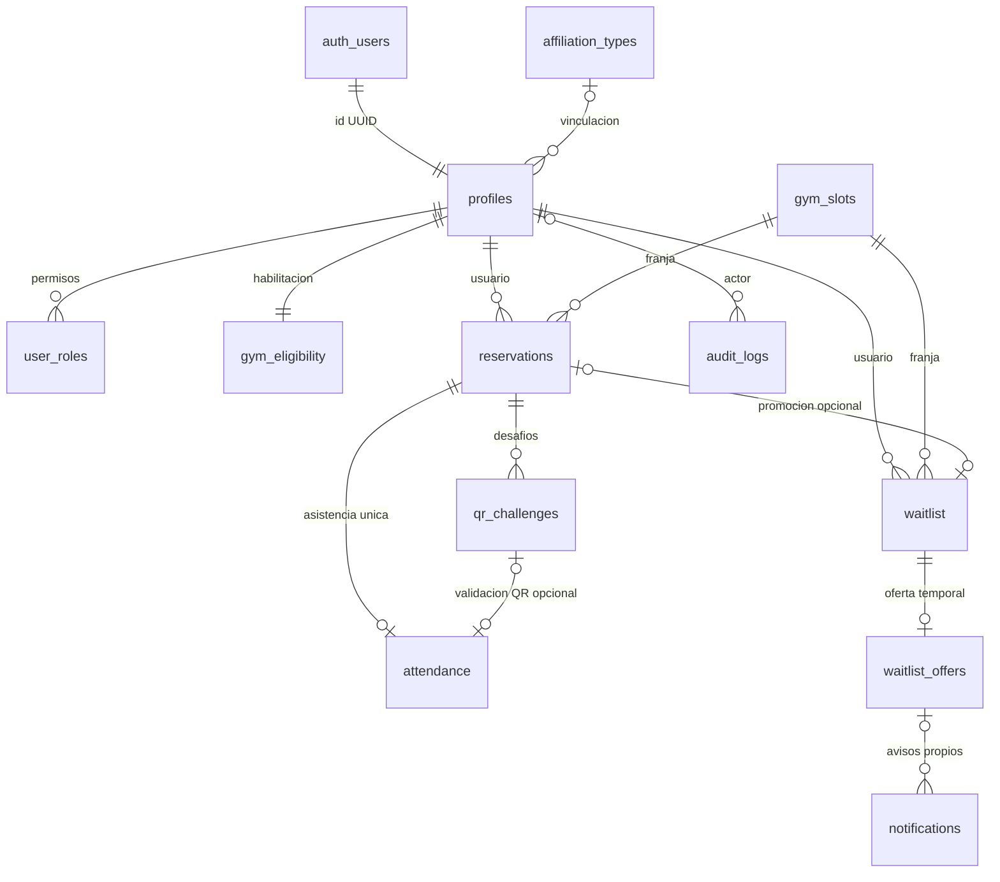

# Modelo de datos de ACTIVANT

## Alcance y conservación

Esta etapa añade el modelo PostgreSQL, sus controles de acceso y una API SQL segura. No incorpora pantallas de reservas, administración de horarios, puntos o recompensas. No se conectó un proyecto remoto ni se modificaron datos de producción.

La migración original `20261113120000_create_profiles.sql` se conserva. Las migraciones posteriores son aditivas:

1. `20261113130000_gym_data_model.sql`: tablas, tipos, índices, claves foráneas, auditoría y RLS.
2. `20261113131000_gym_secure_functions.sql`: operaciones controladas y guardas de integridad.

No se eliminan tablas, no se actualizan los valores de perfiles existentes y no se infieren roles desde metadata. `profiles.affiliation_type` es nullable para conservar perfiles previos sin asignar categorías inventadas. Se crean filas nuevas de rol base `user` y habilitación de gimnasio desactivada para las identidades existentes. Las únicas filas de configuración iniciales son las tres categorías autorizadas y los valores operativos: capacidad 20 y QR de 120 segundos.

## Entidades

| Entidad | Identificador y propósito |
| --- | --- |
| `auth.users` | Fuente única de identidad, administrada por Supabase Auth |
| `profiles` | PK/FK `id = auth.users.id`; estado activo y FK de vinculación |
| `affiliation_types` | Catálogo extensible, separado de permisos: `servidor_planta`, `contratista`, `practicante` |
| `user_roles` | PK `(user_id, role)`; roles `user`, `gym_staff`, `admin`, compatibles entre sí |
| `gym_eligibility` | Una habilitación por perfil: bandera, vigencia y responsable administrativo; sin motivo clínico |
| `gym_slots` | UUID, inicio/fin `timestamptz`, capacidad positiva inicial 20 y estado |
| `reservations` | UUID, usuario/franja, estado y cancelación histórica; una confirmada por usuario/franja |
| `attendance` | PK/FK de reserva: máximo una asistencia por reserva, hora y responsable; método staff o QR |
| `waitlist` | UUID, usuario/franja y estado; una entrada en espera por usuario/franja, vínculo opcional a reserva promocionada |
| `waitlist_offers` | Una oferta por solicitud, identidad/franja compuestas, vencimiento, respuesta, actor y reserva aceptada |
| `notifications` | Avisos propios con clave de evento única y fecha de lectura; sin escrituras directas |
| `gym_availability_signals` | Revisiones de franja para Realtime, sin identidades ni reservas privadas |
| `qr_challenges` | UUID, reserva, hash SHA-256 único, emisor, expiración, consumo o revocación; no persiste token original |
| `app_settings` | Fila única con configuración operativa tipada; sin JSON libre ni secretos |
| `audit_logs` | Identidad de secuencia, actor, rol de conexión, operación y cambios técnicos; solo anexado |

No hay columnas de diagnósticos, notas clínicas, archivos médicos ni motivos de salud. La habilitación es únicamente una decisión administrativa y sus fechas. La metadata de `auth.users` no se copia al perfil o a la autorización. Tampoco se deben introducir datos clínicos en etiquetas o configuraciones.



## Integridad y concurrencia

- `timestamptz` para todos los instantes. La presentación futura debe usar `America/Bogota`; no se almacenan horarios como textos ni se pierde la fecha.
- Un único gimnasio en esta versión: las franjas no canceladas no se solapan, usando exclusión GiST de `tstzrange(..., '[)')`. Las franjas adyacentes están permitidas. Un segundo gimnasio requeriría una dimensión de sede antes de reutilizar este modelo.
- Índices parciales únicos para reservas confirmadas y espera activa. Cancelar conserva el registro y permite una nueva reserva.
- Bloqueo de perfil/habilitación y franja dentro de la transacción antes de confirmar. El conteo de ocupación ocurre bajo el mismo bloqueo, incluso ante peticiones simultáneas.
- Las escrituras de reservas/cupos exigen `READ COMMITTED`; otros aislamientos se rechazan con `0A000`. Así no se usa un snapshot antiguo para contar cupos después de esperar el bloqueo de la franja. Las lecturas pueden usar otros aislamientos.
- El usuario debe estar activo, tener una categoría autorizada activa y una habilitación vigente que cubra la franja completa. Staff/admin no omiten estas reglas al reservar para sí mismos.
- No se disminuye capacidad por debajo de la ocupación ni se reescribe el horario con historial. Una franja no se cancela dejando reservas confirmadas o espera pendiente sin gestionar.
- FK compuestas impiden vincular una espera promocionada a la reserva de otra persona/franja o una asistencia QR al desafío de otra reserva.
- Reserva antes de inicio; asistencia dentro de `[inicio, fin)`. El usuario cancela antes de inicio; un admin puede gestionar cancelación posterior si aún no hay asistencia. Son reglas conservadoras de esta base que podrán evolucionar mediante otra migración.
- Las FK `RESTRICT` preservan historia y responsables. Las cuentas con historia se desactivan; su eliminación definitiva necesita un procedimiento de retención/anonimización futuro, no borrados en cascada.
- La lista tiene orden estable `(created_at, id)`. Las ofertas retienen cupos por un plazo configurable, se aceptan transaccionalmente y se reasignan al rechazar o vencer. Ver [modelo y tareas de espera/notificaciones](waitlist-notifications.md).

## Seguridad y permisos

Todas las tablas de `public` del modelo tienen RLS. No hay acceso `anon`. `authenticated` no tiene INSERT/UPDATE/DELETE de tablas, aunque el perfil sea admin. Las escrituras pasan por funciones con verificación del actor. Los tipos TypeScript describen columnas, no conceden permisos: un tipo `Update` generado no permite evadir las ACL/RLS.

| Datos | Usuario | gym_staff activo | admin activo |
| --- | --- | --- | --- |
| Perfil, roles y habilitación | Solo propios | Solo propios | Todos |
| Agenda y configuración operativa | Perfil activo | Sí | Sí |
| Reservas, asistencia y espera | Solo propios | Datos operativos | Todos |
| Metadata QR | Solo propios | Solo propios | Todos |
| Hash QR | Sin SELECT | Sin SELECT | Sin SELECT |
| Auditoría | No | No | Solo lectura |

`service_role` tampoco recibe escritura arbitraria en estas tablas ni ejecución de las RPC de usuario. Su privilegio elevado de bypass RLS no sustituye permisos SQL ni identidad: las funciones necesitan el JWT del actor y verifican el rol real. La creación de cuentas por Supabase Auth sigue usando su propio servicio y el trigger existente. Las migraciones y mantenimiento SQL de confianza se ejecutan como propietario de base de datos.

`activant_private` contiene helpers y triggers. No debe añadirse a los esquemas expuestos por PostgREST. Los helpers de RLS solo responden sobre el usuario actual y no permiten consultar roles de terceros. Las funciones `SECURITY DEFINER` fijan `search_path=''`, usan relaciones calificadas y revocan EXECUTE de PUBLIC/anon. Un usuario no se asciende mediante JWT metadata; solo cuenta `user_roles` junto con `profiles.is_active`.

Un administrador no cambia su propio rol, su estado de acceso o su habilitación de gimnasio mediante estas RPC. Otro administrador activo o un operador SQL de confianza debe efectuarlo. El primer administrador se establece explícitamente por un operador de confianza después de verificar su UUID real en Auth; ninguna migración promueve automáticamente una cuenta. Ese bootstrap también queda auditado con `database_actor` y actor JWT nulo.

## API SQL

| RPC | Actor y operación |
| --- | --- |
| `admin_set_profile_access` | Admin: estado y vinculación ajenos |
| `admin_set_user_role` | Admin: rol ajeno; conserva rol base |
| `admin_set_gym_eligibility` | Admin: habilitación ajena y vigencia |
| `admin_upsert_affiliation_type` | Admin: ampliar/desactivar categorías |
| `admin_update_app_settings` | Admin: capacidad y TTL del QR personal legado; no configura el QR compartido |
| `admin_create_gym_slot` / `admin_update_gym_slot` | Admin: franjas bajo restricciones de integridad |
| `reserve_gym_slot` / `cancel_gym_reservation` | Usuario propio; admin puede gestionar cancelación ajena |
| `join_gym_waitlist` / `leave_gym_waitlist` | Espera propia; admin puede retirar una entrada |
| `issue_gym_display_qr` | Staff/admin activo: emite QR compartido válido hasta 15 segundos |
| `check_in_gym_qr` | Usuario propio: valida QR, reserva, habilitación, restricciones y ventana; registra asistencia |
| `record_gym_manual_attendance` | Staff/admin activo: ingreso excepcional con motivo y auditoría |

La reserva nunca acepta `user_id` del navegador. La asistencia no acepta hora o responsable elegido por el cliente. Las RPC verifican permisos en SQL además de las guardas de Next.js. La API preliminar `issue_gym_qr_challenge` / `consume_gym_qr_challenge` / `record_gym_attendance` conserva sus objetos e historia, pero pierde EXECUTE de todos los roles de API para impedir rutas alternativas sin los controles actuales.

`activant_private.gym_display_challenges` guarda SHA-256, franja, emisor y vigencia de máximo 15 segundos, sin acceso de clientes. `activant_private.attendance_rate_limits` serializa límites por identidad/operación y conserva los intentos de negocio rechazados. Ambas tablas tienen RLS; solo se accede mediante funciones autorizadas. `attendance.display_challenge_id` referencia el nuevo desafío compartido; `qr_challenge_id` conserva evidencia histórica. Una reserva tiene como máximo una asistencia; un QR compartido puede respaldar varias reservas. `manual_reason` es un código de excepción, sin texto libre ni diagnósticos.

El QR contiene 244 bits aleatorios, sin datos personales ni identificadores. La hora de emisión, vigencia y registro procede de PostgreSQL. Ventana de ingreso: `[starts_at, ends_at)`. Se requiere reserva propia confirmada, cuenta/vinculación/habilitación vigentes y ausencia de restricción activa. Detalles del protocolo, límites, migración y limitaciones de presencia física en [asistencia QR](attendance.md).

## Auditoría

Triggers registran los cambios confirmados de perfiles, roles, habilitaciones, categorías, franjas, reservas, espera, asistencia, QR y configuración, también cuando los realiza un operador SQL. No se registran contraseñas, JWT, token QR ni su hash. Los cambios de auditoría siguen la transacción. Los rechazos previstos de asistencia devuelven resultados para conservar sus contadores; los fallos inesperados se revierten. El registro de seguridad de infraestructura es complementario y no debe incluir tokens ni cuerpos sensibles.

Las asistencias y la bitácora son inmutables mediante UPDATE/DELETE. No existe RPC de borrado o edición de auditoría. El propietario/superusuario puede modificar el esquema o deshabilitar controles: estas guardas no se presentan como protección frente a un administrador del motor comprometido.

## Tipos y pruebas reproducibles

`src/lib/supabase/database.types.ts` fue generado, no escrito manualmente: se usa **`@supabase/typegen`**, generador oficial de Supabase, sobre PostgreSQL 17 migrado. El formato se normaliza con TypeScript ya instalado en el aplicativo. No se accede a un proyecto alojado para generar esta versión.

```powershell
npm.cmd ci
npm.cmd ci --prefix tools/database
npm.cmd run test:db
npm.cmd run db:types
npm.cmd run validate
```

`test:db` comprueba también que la generación coincide exactamente con el archivo versionado. `db:types` vuelve a ejecutar migraciones/pruebas antes de actualizarlo. El lockfile de herramientas está separado; no añade dependencias a producción ni necesita Docker. La primera instalación descarga binarios portátiles de PostgreSQL para la plataforma.

El runner solo conecta a loopback y a un clúster nuevo bajo `.database-tests/`; no admite DATABASE_URL, proyectos remotos ni reinicio de una base existente. Se detiene al finalizar y conserva sus artefactos. `supabase/fixtures/local.sql` contiene únicamente identidades sintéticas con correos `.invalid`, está separado de migraciones/seed automático y rechaza una base sin el prefijo/indicador de prueba. Para cargar historia de una franja ya iniciada, el propietario del clúster aislado suspende una guarda de reserva y la restaura antes de probar; FK, unicidad y auditoría siguen habilitadas.

`tests/database/bootstrap.sql` representa el contrato mínimo de `auth.users`/`auth.uid()` para probar PostgreSQL/RLS; no reemplaza Supabase Auth, no se despliega ni prueba firmas JWT. La suite usa roles SQL reales, sin simular el motor ni las políticas. El pgTAP anterior permanece disponible para una instalación Supabase con la extensión.

## Aplicación a un proyecto real

Revisar las migraciones pendientes frente al esquema real y ensayarlas en un entorno Supabase de prueba antes de aprobar su aplicación remota. El runner no lo hace automáticamente. Conservar copia de seguridad y el historial de migraciones habitual. Comprobar Advisor/RLS de Supabase y regenerar/comparar tipos desde ese proyecto si su esquema difiere. No ejecutar bootstrap o fixtures en producción.

## Extensión futura

- Puntos: ledger append-only por usuario, con FK a asistencia/reserva y unicidad de evento para evitar doble acreditación.
- Sanciones: entidad separada, motivos administrativos tipados y vigencia; no mezclar sanciones con roles ni guardar motivos clínicos.
- Contenidos: catálogo y permisos propios, sin ampliar el significado de la vinculación.
- Recompensas: catálogo y redenciones transaccionales vinculadas al ledger, con su RLS.

No se crean todavía estas tablas ni reglas; los UUID, FK, eventos auditados y configuración tipada permiten incorporarlas mediante nuevas migraciones.

## Fuentes verificadas

- https://supabase.com/docs/guides/database/postgres/row-level-security
- https://supabase.com/docs/guides/database/functions
- https://supabase.com/docs/guides/api/rest/generating-types
- https://github.com/supabase/postgres-meta
- https://www.postgresql.org/docs/17/explicit-locking.html
- https://www.postgresql.org/docs/17/ddl-constraints.html

Referencia adicional de aislamiento: https://www.postgresql.org/docs/17/transaction-iso.html


## Extensión de reservas

`20261113140000_gym_booking.sql` añade apertura configurable (24 horas inicialmente), pausa de reservas y bloqueos administrativos de acceso en `gym_access_restrictions`. Esta tabla referencia al perfil titular y al perfil creador; tiene RLS de lectura propia/administrativa, no admite DML desde el navegador y todas sus operaciones se auditan. No es un módulo de sanciones y no almacena motivos médicos.

La guarda de reserva utiliza una definición común de condiciones con la RPC de disponibilidad agregada. La cancelación ahora es idempotente y conserva el historial. La consulta agregada devuelve cupos sin exponer reservas de otras personas; las consultas directas siguen sujetas a la matriz RLS anterior.

Las comprobaciones SQL actuales son 141: las 122 anteriores y 19 específicas del módulo. Incluyen simultaneidad real de dos solicitantes para un cupo y de dos cancelaciones para la misma reserva. Tipos y hashes del esquema actualizado están en `database-validation.json`. [Reglas, configuración, bloqueo y uso de las interfaces](reservations.md).

## Extensión de constancia

Las tres migraciones `20261113160000`, `20261113161000` y `20261113162000` incorporan el libro de puntos y revisión de inasistencias. No editan las migraciones previas. Las nuevas entidades, relaciones, políticas y RPC están descritas en [puntos y constancia](consistency.md). El saldo deriva de transacciones; las invalidaciones conservan asistencia original y revierten movimientos. Las sanciones se enlazan a las restricciones existentes, con revisión autorizada y calendario institucional verificado. No hay canjes ni backfill.

## Biblioteca y consultas administrativas

Las migraciones `20261113180000` y `20261113181000` incorporan categorías, contenidos, manifiestos de archivos privados, solicitudes de invitación y consultas de indicadores/auditoría. Ver [relaciones, acceso, Storage y definiciones](library-administration.md). Las claves de contenido a archivos/categorías y de creadores/autorizadores a perfiles usan integridad referencial restrictiva. Los contenidos se archivan y las operaciones se auditan; no se borran evidencias.
